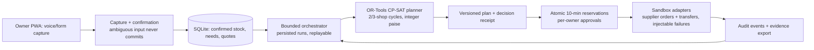

# ShelfLoop — an agent that turns idle stock into useful stock

Bilingual (Hindi/English) assistant for kirana clusters: it plans **replenishment and
multi-shop stock exchanges** under cash, stock, shelf-life and transport constraints,
and never commits anything without per-owner approval of an exact plan version.

Built for hackathon PS 5.1. **Competition-focused prototype; not a guarantee of winning.
All data is synthetic; all exchange execution happens in a labelled sandbox.**

---

## Quick start (one command)

```bat
run.bat          :: Windows
./run.sh         :: macOS / Linux / Git Bash
```

Then open **http://127.0.0.1:8000** — the database seeds itself with 25 shops,
90 catalogue products and the crafted demo scenario.

| Role | PIN |
|---|---|
| Operator | `0000` |
| Shop owner (any shop) | `1234` |

Reset the demo at any time: `cd backend && python -m app.seed`

## The three-minute demo (rehearsed order)

1. **Operator → Planning → Run planner.** CP-SAT returns `OPTIMAL` in well under a
   second at the 25-shop benchmark; the receipt shows exchange cycles, balancing
   payments, transport and the "why not" comparisons (buy-everything / pairwise-only /
   expiry-move-only).
2. **Request approvals.** Every leg's stock is atomically reserved for 10 minutes
   (`AWAITING_APPROVAL`).
3. **Open a separate browser profile as shop 1 (owner PIN 1234) → Today.** Action cards
   answer: what should I do / why / what do I give-receive-spend / what is uncertain /
   what if I decline — with a live reservation countdown and spoken summaries (🔊).
4. **Approve** (all participants must approve the exact `inputs_hash`), then operator
   **Dispatch to sandbox** — revalidation runs first, then transfers and supplier
   orders get acknowledgements, stock actually moves, plan `COMPLETED`.
5. **Failure rehearsal → Withdraw a shop** (e.g. Khan Provision Store), then **Run
   planner** again: the new plan version excludes the withdrawn shop and needs fresh
   approvals. Recovering from a rejected/delayed sandbox action lands the plan in
   `NEEDS_OPERATOR` with visible exceptions instead of silent success.

The demo scenario is crafted so that **no bilateral swap covers all three needs** —
only the three-shop cycle Sharma → Khan → Gupta (Parle-G → Colgate → Surf Excel) does.

## What's inside

- **Operator dashboard** — cluster KPIs (stock value, expiring ≤30/14 days, slow stock, urgent needs, active holds), latest-plan coverage donut, stock-value-by-category chart, searchable/sortable shop directory.
- **Planning workspace** — solver run with verbatim status (`OPTIMAL/FEASIBLE/UNKNOWN`), urgent-only mode, approval progress bar, cash-comparison "why not" bars, and full plan version history with per-version coverage and cash.
- **Interactive exchange graph** — legs coloured per cycle, purchases toggle, click any shop to isolate its flows with per-leg values.
- **Owner app** — Today cards answering the five questions with live reservation countdown and spoken summaries (🔊); **near-expiry advisory strip** (exchange / return-to-distributor / use-first, explicitly labelled advisory, not a safety claim); stock table with expiry badges, share/slow toggles and retained floors; needs with urgency, budget and alternatives; approvals tab with a pending badge; **voice capture** via the browser's built-in Web Speech API (hi-IN/en-IN) feeding the same proposal-gated pipeline.
- **Lifecycle & recovery** — atomic 10-minute reservations, exact-version approvals, pre-dispatch revalidation, NEEDS_OPERATOR exceptions, failure-rehearsal injections (withdraw / drain stock / disconnect) and re-planning into a new version. Dispatch closes (or shrinks) the needs it fulfilled.
- **Evidence** — full audit trail and anonymised export; service worker keeps the shell offline and replays queued capture confirms with the same idempotency key.

- **Look & feel** — Baloo 2 (Devanagari + Latin, bundled offline), hand-drawn logo/shopfront SVGs, stroke icon set, paper-grain background, rubber-stamp status badges, shopkeeper text-size toggle (100/112/125%), greeting by time of day ("Shubh prabhat, Ramesh Sharma ji!"), route-level code splitting and a one-query shop directory (`/api/cases/{case}/directory`) replacing 50 per-shop fetches.

## Architecture



- **Backend** `backend/app`: FastAPI + SQLite (WAL, `BEGIN IMMEDIATE` for reservations),
  OR-Tools CP-SAT. Solver status is reported verbatim — a timeout is `FEASIBLE/UNKNOWN`,
  never "infeasible". Objective order: coverage of owner-confirmed needs (urgent ×2),
  then cash + known costs, then slow-stock redeployment, then transport.
  Analytics: `GET /api/cases/{case}/summary`, `/shops/{id}/expiry-actions`,
  `/cases/{case}/plans` (version history).
- **Frontend** `frontend/`: React + TypeScript + Vite + Tailwind (ivory/indigo/orange),
  owner app (Today / My Stock / My Needs / Approvals) and operator workspace
  (planning, exchange graph, rehearsal, evidence export). Service worker caches the
  shell; capture-confirm queues offline in an outbox and replays with the same
  idempotency key.
- **Contract** `docs/api-contract.md` is the authoritative API shape; `GET /api/cases/cluster-main/events`
  is the full audit trail, `…/export` an anonymised evidence report.

## Evaluation

```bash
cd evaluation
python generate_scenarios.py     # 100 reproducible scenarios (60 cooperative / 20 unfavourable / 20 impossible)
python run_baselines.py          # 4 baselines under identical assumptions
```

Latest run (mean across all 100 scenarios, identical stock/demand/budget/cost):

| Strategy | Coverage | Cash needed | Packs exchanged |
|---|---|---|---|
| manual (unoptimised buying) | 80.0% | ₹538 | 0 |
| replenishment-only | 80.0% | ₹481 | 0 |
| pairwise-only exchange | 80.0% | ₹376 | 2.9 |
| **shelfloop (2/3-shop cycles)** | **80.0%** | **₹313** | **5.1** |

Equivalent fulfilment at **42% less cash** than unoptimised buying, and 75% less than
manual in cooperative scenarios. Details: `evaluation/report.md`, `results.csv`.
Caveat carried into every receipt: **inventory redeployed is not cash released;
avoided expenditure is not measured savings.**

## Tests

```bash
cd backend && python -m pytest tests/ -q      # 21 tests
```

Covers: CP-SAT vs exhaustive enumeration on small cases, retained floors and cash
limits, the bilateral-fails/3-cycle-succeeds property, propose→reserve→approve→dispatch,
rejection releasing reservations, double-allocation prevention under competing plans,
approval-window expiry, withdrawal recovery to a fresh plan version, disconnect blocking
approvals, stock-drain breaking revalidation, ambiguous-capture never committing, and
owner/operator authorisation boundaries (operators cannot approve).

## Honest constraints (also shown inside the product)

- **Voice/invoice capture**: the interface and fallback path exist; local models
  (Faster-Whisper, Tesseract) are optional and not bundled. `POST /api/captures/audio|invoice`
  returns the contract's `manual-form` fallback. An optional Ollama hook enriches text
  parsing if a local model is running; everything stays proposal-gated.
- **Balancing payments and GST**: the sandbox models agreed balancing payments and shows
  goods value / cash / fees separately; it never implies atomic settlement or tax-free
  barter. Exported records leave treatment to the shops' professional process.
- **Sessions**: owner sessions share one browser profile per origin — for the demo, run
  each owner session in a separate browser profile/incognito window (or on phones via a
  tunnel).
- **Voice input** uses the browser's built-in Web Speech API (hi-IN/en-IN) feeding the
  same proposal-gated capture pipeline; **speech output** uses Web Speech synthesis
  rather than eSpeak. Both are free and offline-capable in the browser.

## Roadmap fit

Free to run (no paid APIs), works without a billing system (15 confirmed products is
enough), works without neighbours (replenishment + expiry actions), recovers from
participant withdrawal, and links every recommendation to confirmed stock, quoted costs
and explicit assumptions — the five differentiators from the plan, each visible in the
demo above.
