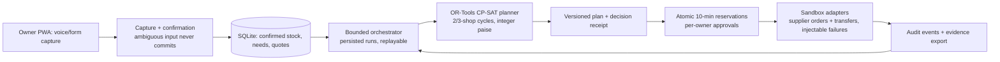

# 🔄 ShelfLoop — turning idle stock into useful stock

**A bilingual (Hindi/English) planning agent for kirana clusters.** ShelfLoop plans replenishment
and **multi-shop stock exchanges** under cash, stock, shelf-life and transport constraints — and
never commits anything without per-owner approval of an exact plan version.


> Built for **Tech4Bharat 2026 — GAVS Hackathon / JanAI Mass Entrepreneurship Challenge**,
> **Problem Statement 5.1 "Kirana stock"** (Agentic AI · Theme 5: Retail, FMCG & Logistics).
> Competition prototype: all data is synthetic, all exchange execution happens in a labelled
> sandbox, and nothing here claims measured field savings — only the evaluation in §12.

---

## Table of contents

1. [The problem](#1-the-problem)
2. [What ShelfLoop does](#2-what-shelfloop-does)
3. [Quick start](#3-quick-start)
4. [The three-minute demo](#4-the-three-minute-demo)
5. [The two apps](#5-the-two-apps)
6. [How the agent works](#6-how-the-agent-works)
7. [The planner](#7-the-planner)
8. [Architecture](#8-architecture)
9. [API overview](#9-api-overview)
10. [Project structure](#10-project-structure)
11. [Tech stack](#11-tech-stack)
12. [Evaluation](#12-evaluation)
13. [Tests](#13-tests)
14. [Configuration reference](#14-configuration-reference)
15. [Offline, voice & i18n](#15-offline-voice--i18n)
16. [Honest constraints](#16-honest-constraints)
17. [What makes it different](#17-what-makes-it-different)
18. [Repository notes](#18-repository-notes)

---

## 1. The problem

From PS 5.1 (verbatim from the organiser brochure):

> **Kiranas tie up cash in dead stock while running out of what sells.**
> Kiranas lose 15–20% of working capital to dead stock while running out of fast movers.
> ₹5,000–10,000 of stock expires every month, festival demand is guessed, and most shops
> have no billing system to learn from.

**What makes it hard:** no clean data, thousands of items known by local names, and anything
built has to prove useful within a week of starting.

**Statement boundaries ShelfLoop honours:** purchases stay within a cash budget the owner sets,
and the owner approves every order.

**Competition conditions it is built for:** voice-first and vernacular, intermittent
connectivity, entry-level Android phones, and clearly disclosed simulated integrations.

## 2. What ShelfLoop does

The mechanism in one sentence: **find feasible 2- and 3-shop exchange cycles that turn slow and
near-expiry stock into the products each shop actually confirmed it needs — bounded by cash
limits, retained floors, remaining shelf life, delivery radius and transport cost — then reserve
stock atomically, get every affected owner's approval on the exact plan version, and dispatch
into a sandbox that can fail loudly.**

It is agentic in the sense the problem statement defines: it **plans over many steps**, **acts in
external systems** (sandbox supplier/transfer adapters), **keeps case memory** (SQLite + a full
audit trail), **recovers from failures** (withdrawal / stock drain / disconnect rehearsals) and
**seeks human approval before any stock or money commitment**.

The demo property (crafted into the seed data): **no bilateral swap covers all three confirmed
needs** — only the three-shop cycle

```
Sharma Kirana ──Parle-G 100g──▶ Khan Provision ──Colgate 100g──▶ Gupta General ──Surf Excel 500g──▶ Sharma
```

…plus bounded balancing payments and transport, closes all three urgent needs.

## 3. Quick start

**Prerequisite: Python 3.10+ only.** No Node toolchain is needed to *run* — the prebuilt
frontend (`frontend/dist/`) is committed and served by the backend. Node 20.19+ is only needed
for frontend development (§3.3).

### 3.1 One command

```bat
run.bat          :: Windows
./run.sh         :: macOS / Linux / Git Bash
```

The launcher creates `backend/.venv`, installs `requirements.txt`, seeds the database on first
start, and serves everything — API **and** app — from one process:

```
http://127.0.0.1:8000        (bound to 0.0.0.0, so phones on the same Wi-Fi can open it too)
```

The database seeds itself deterministically with **25 shops, 90 catalogue products across 28
categories (with Hindi names + aliases), 135 stock lots, 50 needs and 90 supplier quotes** —
including the crafted three-shop scenario above.

### 3.2 Demo logins

| Role | PIN | Scope |
|---|---|---|
| Operator (cluster coordinator) | `0000` | planning, dispatch, sandbox rehearsal, evidence |
| Shop owner (any shop) | `1234` | own shop only: stock, needs, capture, approvals |

> Owner sessions share one browser profile per origin — run each owner session in a separate
> browser profile / incognito window (or on phones via the LAN address).

Reset the demo at any time:

```bash
cd backend && python -m app.seed
```

### 3.3 Manual setup & development

```bash
# backend
cd backend
python -m venv .venv && .venv/Scripts/pip install -r requirements.txt   # Windows
# source .venv/bin/activate && pip install -r requirements.txt          # macOS/Linux
.venv/Scripts/python -m uvicorn app.main:app --port 8000 --app-dir .    # or run from backend/ plainly

# frontend dev server (hot reload; proxies /api → localhost:8000)
cd ../frontend
npm install
npm run dev          # http://localhost:5173

# production build
npm run build        # tsc -b && vite build → frontend/dist (served by the backend)
npm run lint         # oxlint
```

## 4. The three-minute demo

Rehearsed order for judges:

1. **Operator → Planning → Run planner.** CP-SAT returns `OPTIMAL` in well under a second at
   the 25-shop benchmark. The decision receipt shows exchange cycles, balancing payments,
   transport, per-need coverage — and the **"why not" comparisons** (buy-everything /
   pairwise-only / expiry-move-only).
2. **Request approvals.** Every leg's stock is atomically **reserved for 10 minutes**
   (`AWAITING_APPROVAL`), with a live countdown.
3. **Open a separate browser profile as shop 1 (owner PIN 1234) → Today.** Action cards answer
   the five questions — *what should I do / why / what do I give-receive-spend / what is
   uncertain / what if I decline* — with 🔊 spoken summaries in Hindi or English.
4. **Approve** (every participant must approve the exact `inputs_hash`), then operator
   **Dispatch to sandbox**: revalidation runs first, then transfers and supplier orders get
   acknowledgements, stock actually moves, plan → `COMPLETED`, and the needs it fulfilled close
   or shrink.
5. **Failure rehearsal → Withdraw a shop** (e.g. Khan Provision Store), then **Run planner**
   again: the new plan version excludes the withdrawn shop and needs fresh approvals. A
   rejected/delayed sandbox action lands the plan in `NEEDS_OPERATOR` with visible exceptions —
   never silent success.

## 5. The two apps

### Operator workspace (`/operator`)

- **Overview** — cluster KPIs (stock value, expiring ≤30/14 days, slow stock, urgent needs,
  active holds), latest-plan coverage donut, stock-value-by-category chart, searchable/sortable
  shop directory (one query, `/api/cases/{case}/directory` — replaces 50 per-shop fetches).
- **Planning** — solver run with verbatim status (`OPTIMAL/FEASIBLE/UNKNOWN`), urgent-only mode,
  approval progress bar, cash-comparison "why not" bars, full plan version history with
  per-version coverage and cash.
- **Exchange graph** — interactive legs coloured per cycle, purchases toggle, click any shop to
  isolate its flows with per-leg values.
- **Rehearsal** — sandbox failure injections (withdraw / drain stock / disconnect) and reset.
- **Evidence** — full audit trail and one-click anonymised export.

### Owner app (`/shop`)

- **Today** — action cards answering the five questions, live reservation countdown, 🔊 spoken
  summaries, time-of-day greeting ("Shubh prabhat, Ramesh Sharma ji!").
- **Near-expiry advisory strip** — exchange / return-to-distributor / use-first, explicitly
  labelled *advisory, not a safety claim*.
- **My Stock** — expiry badges, share/slow toggles, retained floors.
- **My Needs** — urgency, budget, alternatives.
- **Voice capture** — browser Web Speech API (hi-IN/en-IN) feeding the same proposal-gated
  pipeline as typed capture; ambiguous input is asked about, never guessed.
- **Approvals** — pending badge; approve/reject the exact plan version.

**Look & feel:** Baloo 2 (Devanagari + Latin, bundled offline), hand-drawn shopfront/logo SVGs,
stroke icon set, paper-grain background, rubber-stamp status badges, shopkeeper text-size toggle
(100/112/125%), full Hindi ⇄ English UI switch, route-level code splitting.

## 6. How the agent works

### 6.1 Plan lifecycle (authoritative)

```
PROPOSED → AWAITING_APPROVAL → APPROVED → SANDBOX_DISPATCHED → COMPLETED
Terminal alternates: REJECTED · EXPIRED · CANCELLED · NEEDS_OPERATOR
```

- Entering `AWAITING_APPROVAL` **atomically reserves every leg's stock for 10 minutes**
  (SQLite WAL, `BEGIN IMMEDIATE` — double allocation under competing plans is impossible).
- **Every affected owner must approve the exact plan version** (`inputs_hash`). Operators are
  *rejected at the API* on decision endpoints.
- **Dispatch revalidates** reservations, stock versions and budgets *before* running sandbox
  actions; only then does stock move.
- Rejection / reservation timeout releases reservations. Any material change ⇒ **new plan
  version ⇒ fresh approvals** — no stale approval is ever honoured (HTTP 409 otherwise).
- Partial sandbox handoffs become exceptions; plan → `NEEDS_OPERATOR` with visible exceptions.

### 6.2 Capture pipeline (propose-only; ambiguous input never commits)

```
voice (Web Speech API) or typed text (Hindi / English / code-switched)
  → POST /api/captures           → proposals with confidence + product matches
  → ambiguous? ("₹10 wala biscuit" matching 3 SKUs) → clarification_needed + candidate list
  → owner edits & confirms       → POST /api/captures/{id}/confirm  (Idempotency-Key header)
  → applied to confirmed stock/needs — the only data the planner ever uses
```

- `POST /api/captures/audio|invoice` return the contract's `manual-form` fallback when optional
  local models are unavailable — the UI always shows the manual form, so capture never dead-ends.
- An **optional Ollama hook** (`qwen3:4b` at `localhost:11434`, 2 s timeout) enriches text
  parsing if a local model is running; everything stays proposal-gated either way.
- Inventory writes and capture confirms are idempotent (cached response replay on retry).

### 6.3 Sandbox & failure rehearsal

```
POST /api/sandbox/inject  {type: "withdraw_shop" | "reduce_stock" | "disconnect", shop_id, …}
```

| Injection | Effect |
|---|---|
| `withdraw_shop` | plan invalid at revalidation → `NEEDS_OPERATOR`; operator re-plans → new version, fresh approvals |
| `reduce_stock` | breaks reservation revalidation → dispatch blocked |
| `disconnect` | blocks approvals + loses one sandbox ack → partial handoff exception |

## 7. The planner

- **Engine:** OR-Tools **CP-SAT** over 2- and 3-shop directed exchange cycles, all money in
  **integer paise** (₹1 = 100; no floats anywhere). Enumeration guards: `MAX_CYCLES = 20000`,
  ≤ 3 candidate products per ordered shop pair.
- **Objective (lexicographic priority):**
  1. coverage of owner-confirmed needs (urgent × 2 weight, `COVERAGE_WEIGHT = 1,000,000`/pack),
  2. cash + known costs,
  3. slow-stock redeployment (₹3/pack preference bonus),
  4. transport (₹2/pack-km + ₹50 per-cycle call-out, split evenly).
- **Hard constraints:** per-shop cash-out ≤ owner's cash limit; stock never shared below its
  retained floor; ≥ `min_shelf_days` (default 14) remaining at handoff; 3 km cluster radius.
- **Solver honesty:** status reported verbatim — a timeout is `FEASIBLE`/`UNKNOWN`, never
  "infeasible"; `proven_optimal` is shown separately.
- **Decision receipt:** cycles with per-leg values, balancing payments per shop, purchases,
  per-need coverage with source, cash-out per shop, assumptions list, approval history, and
  **"why not"** comparisons against *buy-everything*, *pairwise-only* and *expiry-move-only*.
- **Money semantics:** balancing payments are modelled inside this plan only (positive = shop
  pays, negative = owed) and never netted across plans; the receipt separates goods value, cash,
  transport and fees.

## 8. Architecture



- **One process** serves API and SPA: FastAPI mounts `frontend/dist` at `/` (SPA fallback to
  `index.html`), API under `/api`. CORS open for dev; the built app talks same-origin.
- **Backend** (`backend/app/`): FastAPI + SQLite (WAL, `BEGIN IMMEDIATE` for reservations) +
  OR-Tools CP-SAT. Modules: `capture` (parsing/ambiguity), `planner/solve|graph|brute` (CP-SAT
  + exhaustive cross-check), `lifecycle` (state machine, reservations, approvals, dispatch),
  `sandbox` (adapters + injections), `routes/api` (37 endpoints), `seed` (deterministic demo).
- **Frontend** (`frontend/src/`): React 19 + TypeScript + Vite + Tailwind (ivory/indigo/orange),
  React Router 7, owner/operator route trees, i18n dictionary, speech helpers, offline outbox.
- **Contract:** `docs/api-contract.md` is the authoritative API shape (v1).
- **SQLite schema (17 tables):** `shops, products, aliases, stock_lots, needs, supplier_quotes,
  captures, planning_runs, plans, reservations, approvals, sandbox_actions, sandbox_state,
  audit_events, idempotency, sessions, inventory_log`.

## 9. API overview

Base `http://localhost:8000/api` · bearer token from `POST /api/session` · all money **integer
paise** · errors `{detail}` with 400/401/403/404/409 (409 = state conflict, e.g. approving a
superseded version). Full shapes: [`docs/api-contract.md`](docs/api-contract.md).

| Group | Endpoints |
|---|---|
| Session & health | `POST /session` · `GET /health` |
| Reference data | `GET /shops` · `GET /products` · `GET /shops/{id}/stock` · `GET /shops/{id}/needs` · `GET /supplier-quotes` |
| Capture (propose-only) | `POST /captures` · `POST /captures/audio` · `POST /captures/invoice` · `POST /captures/{id}/confirm` |
| Confirmed writes | `POST /inventory/confirm` · `POST /needs` · `DELETE /needs/{id}` · `POST /supplier-quotes` |
| Planning | `POST /planning-runs` · `GET /planning-runs/{id}` |
| Plans & decisions | `GET /plans/{id}` (receipt) · `GET /plans/{id}/status` · `POST /plans/{id}/submit` · `/approve` · `/reject` · `/cancel` · `/dispatch` |
| Analytics | `GET /cases/{case}/summary` · `GET /cases/{case}/directory` · `GET /shops/{id}/pulse` · `GET /shops/{id}/expiry-actions` · `GET /shops/{id}/plans` · `GET /cases/{case}/plans` |
| Sandbox | `POST /sandbox/inject` · `POST /sandbox/reset` · `GET /sandbox/state` |
| Audit / evidence | `GET /cases/{case}/events` · `GET /cases/{case}/export` |

Server-side authorisation rule: **only an owner token for shop X can approve/reject for shop X;
operator tokens are rejected on decision endpoints.**

## 10. Project structure

```
shelfloop/
├── README.md                      ← you are here
├── run.bat / run.sh               ← one-command launcher (venv + deps + seed + serve)
├── docs/
│   └── api-contract.md            ← authoritative API contract (v1)
├── data/                          ← shelfloop.db (gitignored; regenerated by seed)
├── backend/
│   ├── requirements.txt           ← fastapi, uvicorn, pydantic 2, ortools, httpx, pytest
│   ├── app/
│   │   ├── main.py                ← FastAPI app; serves API + built SPA
│   │   ├── config.py              ← all tunables (§14); money = integer paise
│   │   ├── db.py                  ← SQLite WAL schema, migrations, helpers
│   │   ├── capture.py             ← text parsing, aliases, ambiguity detection
│   │   ├── lifecycle.py           ← plan state machine, reservations, approvals, dispatch
│   │   ├── sandbox.py             ← supplier/transfer adapters + failure injections
│   │   ├── seed.py                ← deterministic 25-shop demo incl. crafted trio
│   │   ├── planner/
│   │   │   ├── solve.py           ← CP-SAT model (coverage → cash → slow → transport)
│   │   │   ├── graph.py           ← 2/3-shop cycle candidate generation
│   │   │   └── brute.py           ← exhaustive enumeration (cross-check in tests)
│   │   └── routes/api.py          ← all 37 endpoints
│   └── tests/                     ← 21 pytest tests (§13)
├── frontend/
│   ├── package.json               ← React 19, Router 7, Tailwind 3, Vite 8, oxlint
│   ├── vite.config.ts             ← dev proxy /api → :8000
│   ├── public/                    ← favicon, icon sprite, manifest, service worker
│   ├── dist/                      ← committed production build (no Node needed to run)
│   └── src/
│       ├── api/                   ← client, discovery, outbox (offline replay), session store
│       ├── components/            ← ExchangeGraph, PlanReceipt, Countdown, StatusChip, …
│       ├── pages/operator/        ← Overview, Planning, GraphPage, Rehearsal, Evidence
│       ├── pages/owner/           ← Today, Stock, Needs, Approvals, CaptureComposer
│       ├── state/                 ← Session, Toast contexts
│       ├── lib/                   ← speech, formatting, hooks
│       └── i18n.ts                ← Hindi ⇄ English dictionary
└── evaluation/
    ├── generate_scenarios.py      ← 100 reproducible scenarios
    ├── run_baselines.py           ← 4 baselines under identical assumptions
    ├── scenarios.json / results.csv
    └── report.md                  ← per-scenario-kind breakdown
```

## 11. Tech stack

| Layer | Choice |
|---|---|
| Backend | Python 3.10+, FastAPI ≥ 0.115, Uvicorn, Pydantic 2 |
| Optimisation | Google **OR-Tools ≥ 9.10** (CP-SAT) |
| Storage | SQLite (WAL journal, `BEGIN IMMEDIATE` transactions) — zero-infra, file-based |
| Frontend | **React 19**, React Router 7, TypeScript ~6.0, **Vite 8**, Tailwind CSS 3.4 |
| Fonts & icons | Baloo 2 (`@fontsource/baloo-2`, bundled offline), hand-drawn SVG logo/shopfronts |
| Voice | Browser Web Speech API — recognition hi-IN/en-IN, synthesis for 🔊 summaries |
| Offline | PWA service worker (`sw.js`) + manifest; idempotency-keyed outbox replay |
| Lint / test | oxlint; pytest ≥ 8 (21 tests) |
| Optional AI | Ollama (`qwen3:4b`) for capture enrichment — degrades gracefully |

## 12. Evaluation

```bash
cd evaluation
python generate_scenarios.py     # 100 reproducible scenarios (60 cooperative / 20 unfavourable / 20 impossible)
python run_baselines.py          # 4 baselines under identical assumptions
```

All strategies solve the **same** scenarios with identical stock, demand, budgets and costs.
Latest run — mean across all 100 scenarios:

| Strategy | Coverage | Cash needed | Packs exchanged |
|---|---|---|---|
| manual (unoptimised buying) | 80.0% | ₹538 | 0 |
| replenishment-only | 80.0% | ₹481 | 0 |
| pairwise-only exchange | 80.0% | ₹376 | 2.9 |
| **shelfloop (2/3-shop cycles)** | **80.0%** | **₹313** | **5.1** |

- **Equivalent fulfilment at 42% less cash** than unoptimised buying overall.
- In **cooperative** scenarios (where exchanges are possible): shelfloop ₹322 vs manual ₹673 —
  **52% less cash** (unfavourable scenarios reduce to replenishment-only by design; impossible
  ones return 0% coverage honestly).
- 80% overall coverage is by construction: scenarios where needs exceed budgets stay unmet —
  the agent reports them rather than over-spending.

> **Caveat carried into every receipt:** inventory redeployed is not cash released; avoided
> expenditure is not measured savings. Synthetic scenarios only.

Details: [`evaluation/report.md`](evaluation/report.md) · [`evaluation/results.csv`](evaluation/results.csv).

## 13. Tests

```bash
cd backend && python -m pytest tests/ -q      # 21 tests, all passing
```

Coverage highlights:

- **Solver correctness** — CP-SAT vs exhaustive enumeration on small cases; retained floors and
  cash limits; the *bilateral-fails / 3-cycle-succeeds* property.
- **Lifecycle** — propose → reserve → approve → dispatch; rejection releases reservations;
  double-allocation prevention under competing plans; approval-window expiry.
- **Recovery** — withdrawal re-plans into a fresh version; disconnect blocks approvals;
  stock-drain breaks revalidation → `NEEDS_OPERATOR`.
- **Safety** — ambiguous capture never commits; owner/operator authorisation boundaries
  (operators cannot approve).

## 14. Configuration reference

All tunables live in [`backend/app/config.py`](backend/app/config.py):

| Constant | Value | Meaning |
|---|---|---|
| `RESERVATION_TTL_S` | 600 | stock hold while awaiting approvals (10 min) |
| `DEFAULT_MIN_SHELF_DAYS` | 14 | shelf-life threshold at handoff (not a safety certification) |
| `DEFAULT_TIME_LIMIT_MS` | 5000 | CP-SAT time limit per run |
| `DEFAULT_RADIUS_KM` | 3.0 | cluster radius for exchanges |
| `TRANSPORT_RATE_PAISE_PER_PACK_KM` | 200 | ₹2 per pack-km (shown on receipts) |
| `TRANSPORT_BASE_PAISE` | 5000 | ₹50 per-cycle call-out, split evenly |
| `SLOW_REDEPLOY_BONUS_PAISE` | 300 | per-pack preference for marked slow stock |
| `COVERAGE_WEIGHT` | 1,000,000 | objective weight per urgency-weighted pack |
| `URGENCY_WEIGHTS` | urgent ×2, normal ×1 | need urgency weighting |
| `MAX_CYCLES` / `MAX_PRODUCTS_PER_PAIR` | 20000 / 3 | enumeration guards |
| `OWNER_PIN` / `OPERATOR_PIN` | `1234` / `0000` | demo credentials |
| `OLLAMA_HOST` / `OLLAMA_MODEL` / `OLLAMA_TIMEOUT_S` | `localhost:11434` / `qwen3:4b` / 2.0 | optional capture enrichment |
| `CASE_ID` | `cluster-main` | the demo case |

## 15. Offline, voice & i18n

- **Service worker** caches the app shell for offline use; the database-backed API is local.
- **Offline capture:** capture confirms queue in an outbox and replay with the **same
  idempotency key** — no duplicate stock entries after reconnect.
- **Voice input** uses the browser's built-in Web Speech API (hi-IN / en-IN), feeding the same
  proposal-gated pipeline; **speech output** uses Web Speech synthesis (🔊 on Today cards).
  Both are free and offline-capable in the browser — no paid APIs anywhere in the project.
- **Hindi ⇄ English** UI toggle across both apps; product names, aliases and greetings are
  bilingual end-to-end.

## 16. Honest constraints

Also shown inside the product itself:

- **Voice/invoice capture**: the interface and fallback path exist; local models
  (Faster-Whisper, Tesseract) are optional and not bundled. `POST /api/captures/audio|invoice`
  returns the contract's `manual-form` fallback; an optional Ollama hook enriches text parsing
  if a local model is running. Everything stays proposal-gated.
- **Balancing payments and GST**: the sandbox models agreed balancing payments and shows goods
  value / cash / fees separately; it never implies atomic settlement or tax-free barter.
  Exported records leave treatment to the shops' professional process.
- **Sessions**: owner sessions share one browser profile per origin — for the demo, run each
  owner session in a separate browser profile/incognito window (or on phones via a tunnel).
- **Advisory, not safety**: the near-expiry strip and the 14-day shelf-life threshold are
  planning aids, explicitly labelled — never food-safety claims.
- **Synthetic data**: all shops, stock and needs are seeded fiction; the evaluation is
  scenario-based, not field-measured.

## 17. What makes it different

1. **Constraint-aware multi-party coordination** — 3-shop cycles with balancing payments,
   transport, shelf-life and cash bounds; not a listing/swap marketplace.
2. **Voice-first bilingual capture that never guesses** — ambiguity produces a clarifying
   question, not a silent commit.
3. **Human-in-the-loop by construction** — atomic reservations, exact-version approvals,
   operators structurally barred from approving.
4. **Failure recovery as a feature** — withdrawal / drain / disconnect rehearsals re-plan into
   new versions; exceptions are visible, never silent success.
5. **Honest receipts** — verbatim solver status, "why not" comparisons, printed assumptions,
   and caveats carried into every plan and the evaluation.

Free to run (no paid APIs), works without a billing system (15 confirmed products is enough),
works without neighbours (replenishment + expiry actions), and links every recommendation to
confirmed stock, quoted costs and explicit assumptions.

## 18. Repository notes

- `data/`, `backend/.venv/`, `node_modules/`, `__pycache__/` are gitignored; the database is
  **regenerated deterministically** by `python -m app.seed`, so a fresh clone needs no data.
- `frontend/dist/` **is committed** — the backend serves it, so running the project needs only
  Python. Rebuild it with `npm run build` after frontend changes.
- The seed is deterministic (`random.seed`-fixed), so demo numbers repeat exactly.
- Everything (planner runs, approvals, sandbox actions, injections) is written to
  `audit_events`; `GET /api/cases/cluster-main/export` downloads an anonymised evidence report.
- Built for the **Tech4Bharat 2026 (GAVS / JanAI) hackathon** — problem statement selection
  notes and organiser brochures live in `../research/` (not part of the app).
